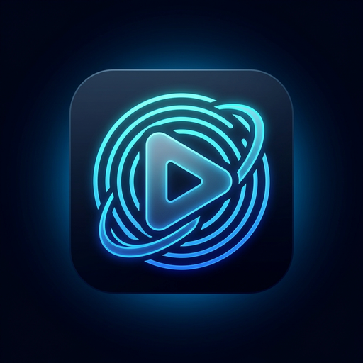

<p align="center">
  
</p>

<h1 align="center">Nuvio with Torrents</h1>

<p align="center">
  <strong>The Sovereign Native BitTorrent Streaming Powerhouse for PlayStation 5.</strong><br>
  <em>Engineered and maintained by <strong>chewlord76</strong>.</em>
</p>

<p align="center">
  <a href="https://github.com/chewlord76/nuvio-with-torrents/releases/latest"></a>
  <a href="LICENSE"></a>
  <a href="https://github.com/chewlord76/nuvio-with-torrents"></a>
  
</p>

---

## ⚡ Overview

**Nuvio with Torrents** is an uncompromising, fully autonomous media streaming powerhouse created natively for jailbroken PlayStation 5 consoles. 

Unlike traditional console media centers that demand external companion servers, paid Real-Debrid subscriptions, or separate computers running streaming proxy scripts, **Nuvio with Torrents features a custom-engineered, multi-threaded C++ BitTorrent streaming engine running bare-metal inside the PS5 application process**.

From ultra-high-bitrate **80+ GB 4K UHD Blu-ray REMUXes** to everyday web releases, Nuvio with Torrents streams peer swarms sequentially with instantaneous buffer calculation, genuine 10-bit Rec.2020 HDR10 scanout, zero transcoding, and a sleek, distraction-free console interface completely stripped of all donation prompts and third-party update nags.

---

## 🌟 Crown Architectural Features

### 🧲 Sovereign Native BitTorrent Streaming Engine
* **100% Standalone on Console**: Streams torrents and magnet links directly from peer swarms. No PC, Docker host, companion server, or Debrid account required.
* **Massive Multi-Piece Lookahead Pipelining**: Demolished legacy single-piece download bottlenecks. The engine maintains up to **32 concurrent pieces in flight simultaneously**, pre-buffering $N+1, N+2, N+3...$ lookahead windows at line rate.
* **Instantaneous Seek Recovery**: Re-engineered seeking architecture. Skips forward or backward instantly flush legacy queue state, release seek gates, and re-prime the playhead without decoder deadlock or file system abandonment.
* **True Piece-by-Piece Buffering Progress**: The buffering HUD accurately tracks exact byte progress across missing piece blocks instead of stalling at a blind `0%`.
* **Live Dynamic Swarm HUD**: Swarm statistics (download speed, seeds, peers, buffer health) poll continuously every second, eliminating stale `0.0 MB/s` visual lag.
* **Optimized High-Speed Socket Fabric**: 2 MB TCP receive socket buffers and `TCP_NODELAY` deliver sustained 30–50+ MB/s line-rate throughput on fiber and gigabit connections.

### 🎨 4K UHD 60/120 Hz & True 10-Bit HDR10 Pipeline
* **Direct Prospero AGC GPU Rendering**: Native-resolution 4K rendering via hardware-accelerated OpenGL 4.6 and direct Agc compute shaders.
* **10-Bit Rec.2020 HDR10 Scanout**: Verified PS5 kernel handshake (`attribute: 0x62000000`) directs the display manager to grant authentic 10-bit Rec.2020 PQ scanout to OLED and HDR TVs.
* **Automatic ITU-R BT.1886 HDR-to-SDR Tone Mapping**: If your TV or display profile is in SDR mode, high-precision shader luminance mapping compresses wide gamut BT.2020 without clipped highlights or washed-out tones.

### 📱 Local Web Drop Companion (`:8088`)
* **Built-in HTTP Web Portal**: Lightweight web server running directly on your PS5 (`http://<ps5-ip>:8088`).
* **Instant Phone / PC Casting**: Scan the on-screen QR code from your phone or visit the address on your laptop to drag-and-drop `.torrent` files or paste magnet links directly to your big screen.

### 💾 USB Flash Drive & Local Storage Auto-Detection
* **Multi-Port Drive Scanning**: Automatically indexes `.torrent` files on any connected USB flash drive or SSD (`/mnt/usb0` through `/mnt/usb7`) and internal console storage (`/data/torrents/`, `/data/`).
* **Deep Multi-File Layout Inspection**: Seamlessly browse episodes, seasons, or bonus features inside complex torrent packs.
* **Stateful Resume & Watch History**: Remembers your exact watch progress across sessions with dedicated **Resume** and **Play from beginning** controls.

### 🛡️ Pure, Distraction-Free Console UX
* **Cleaned of External Influence**: Completely eliminated all author donation screens, Ko-fi links, QR codes, and persistent update nagging.
* **Instant Boot**: No modal questions or install source interruptions; launches straight into your media library.

---

## 📦 Installation Packages & Setup

### Requirements
* A PlayStation 5 running compatible homebrew-enabled firmware (target: 13.60+).
* An active payload environment with **ShadowMount+** (1.7+) or **Itemzflow Game Manager**.

### Download Official Packages

| Package File | Best For | Installation Instructions |
| :--- | :--- | :--- |
| **`PPSA99288.ffpfsc`** | **ShadowMount+ 1.7** *(Recommended)* | Copy `.ffpfsc` to your USB drive or into `/data/` on the PS5. Open ShadowMount+ and select the image to mount. |
| **`PPSA99288.zip`** | **Itemzflow Game Manager** | Extract `PPSA99288.zip`. Copy the unzipped `PPSA99288` directory to `/user/app/PPSA99288/` on your console. |

> **Title ID:** `PPSA99288` · App Name: **Nuvio with Torrents**

---

## 🕹️ Controls Quick Reference

| Button | Action |
| :--- | :--- |
| **Cross (✕)** | Select / Play stream / Confirm |
| **Circle (○)** | Back / Cancel / Stop playback |
| **Square (□)** | Stream Options Menu: **Resume**, **Play from beginning**, **Select file**, **Remove** |
| **Triangle (△)** | Quick Search / Paste Magnet / Filter |
| **L1 / R1** | Switch view filters (All Sources, Local USB Files, Recent Streams) |
| **D-Pad Left / Right** | Skip backward / forward (configurable seek interval) |
| **D-Pad Up / Down** | Open playback HUD, audio tracks, and chapter selection |
| **Options** | Audio track, subtitle shaping, and video output options |

---

## 🚀 How to Stream Torrents

### 1. Via Web Drop (Easiest)
1. Open **Nuvio with Torrents** on your PS5.
2. Go to the **Torrents** tab in the sidebar and select **Phone / PC Web Drop (QR Code)**.
3. Scan the QR code or enter `http://<ps5-ip>:8088` into your phone or PC browser.
4. Drag-and-drop any `.torrent` file or paste a magnet link. Playback starts immediately on your TV!

### 2. Via USB Flash Drive / Storage
1. Copy your `.torrent` files to a USB flash drive.
2. Plug the drive into your PS5.
3. Navigate to **Torrents** → **Local .torrent files**.
4. Press **Cross (✕)** to stream, or **Square (□)** to select specific episodes or files.

### 3. Via Direct Magnet Entry
1. Select **Enter Magnet or .torrent URL** in the Torrents hub.
2. Paste any `magnet:?xt=urn:btih:...` link.

---

## 🏗️ Building from Source

Builds are compiled inside a Linux environment (Ubuntu 22.04+ or WSL2 on Windows) with the PS5 Open SDK toolchain.

```bash
# Clone the repository
git clone https://github.com/chewlord76/nuvio-with-torrents.git
cd nuvio-with-torrents/source/native-app

# Run the automated PS5 build script
bash auto_build_ps5.sh
```

Packaged outputs will be placed in `READY_FOR_PS5/`:
- `READY_FOR_PS5/PPSA99288.ffpfsc`
- `READY_FOR_PS5/PPSA99288.zip`

---

## 📜 Credits & License

* **Project Architect & BitTorrent Engine Lead:** Developed, optimized, and maintained by **chewlord76**.
* **Base Platform:** Adapted from the open-source Nuvio foundation and re-engineered for standalone high-bitrate torrent streaming.
* **Underlying Engines:** Powered by Prospero AGC, QuickJS, FFmpeg, and libvlc.
* **License:** Distributed under the **[GNU General Public License v3.0](LICENSE)**.
